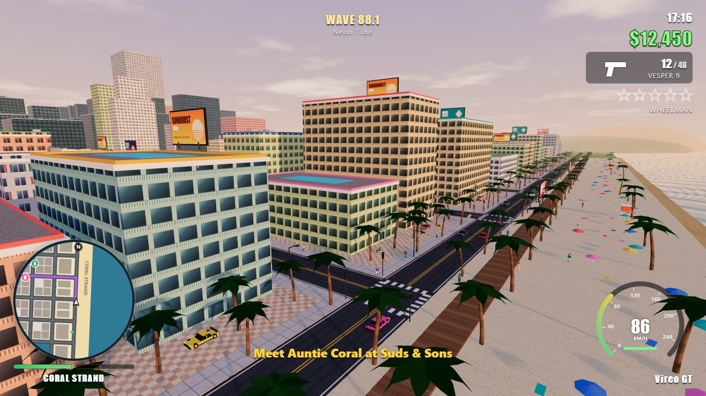

# Palmwire City

An original open-world crime game set on a sun-soaked stretch of coast. It runs offline in desktop
Chrome from static files (`game/index.html`), uses keyboard and mouse, and generates every texture,
sound and song in the browser. Three.js is the only library, vendored as `game/vendor/three.module.min.js`.



## The city

Palmwire City is built from a fixed seed into a 14 × 14 grid of blocks:

| District | What's there |
| --- | --- |
| **Halcyon Downtown** | Glass and stucco towers, stepped skyscrapers, helipads, plazas |
| **Mirador** | Pastel deco low-rises, awnings, rooftop billboards, parking lots |
| **Seagrass Heights** | Bungalows with gable roofs, gardens, pools, driveways |
| **Coral Strand** | A hotel strip, a palm-lined boulevard, the boardwalk, umbrellas, lifeguard towers, the lighthouse |
| **Saltworks Docks** | Warehouses, container stacks, tanks and harbour cranes on the quay |
| **Crestline Park** | A grassy hill with a gazebo and a radio mast |
| **Pelican Bay** | Sailboats, a marina and the cable-stayed bay bridge |

Roads carry lane markings, crosswalks and traffic signals. The sea is an animated shader with surf
along the beach. A day/night cycle drives the sun, shadows, fog, sky (with clouds and stars), lit
windows, street lamps and headlights. The sun sets over the ocean.

## What you can do

- **On foot:** third-person camera with mouse look, run, sprint, jump, swim. Fight with fists, the
  Vesper 9 pistol, the Hornet SMG and the Breaker 12 shotgun. Guns have ammo, reloads, aiming,
  recoil, muzzle flashes and tracers. You have health and body armour.
- **Vehicles:** nine original makes: Pelican Hatch, Seabright Sedan, Thunderhead SS, Mesquite
  Pickup, Vireo GT, Coastline Van, Wasp 250 motorbike, Palmwire Cab and the PCPD Interceptor.
  Handling is arcade-style, with handbrake drifts, skid marks, tyre smoke and damage. Cars catch
  fire and explode. There is a horn and a radio.
- **A living street:** traffic follows lanes and obeys the signals, brakes for people and honks.
  Pedestrians walk their blocks, cross at corners, dodge cars and scatter or cower when shooting
  starts. You can steal parked cars or pull drivers out of traffic.
- **Wanted level (0–5 stars):** crimes add heat, and witnesses call it in. Cruisers route to you
  and ram, officers get out to arrest or shoot, roadblocks appear from 3 stars and a searchlight
  helicopter joins at 4. Break line of sight to lose them. Getting killed means **FLATLINED**
  (hospital bill); getting arrested means **CUFFED** (bail, and your weapons are taken).
- **Story — "Last Tide":** Rae Solano comes home after three years upstate. She finds Victor Hale's
  Marrow Company buying up Coral Strand with bribes, while the Gullcrest Kings do his collecting.
  There are seven missions from Auntie Coral (Suds & Sons Laundromat) and Dex Okafor (Rust & Chrome
  Garage): *Homecoming, Paint Job, Hard Rinse, Heat Check, Courier Run, Hale's Ledger, Last Tide*.
  They use dialogue cards with drawn portraits, phone calls, objectives, timers, a GPS route,
  rewards, respect ranks and unlocks (SMG, shotgun, safehouse armour).
- **Side jobs:** the *Sunset Sprint* street race over the bridge, *Palmwire Cab* fares and the
  *Kings' Turf* rampage.
- **Safehouse:** Seagrass Apartments. Press E there to save, heal and restock armour.
  Continue the game from the title screen.

## Controls

| Key | Action |
| --- | --- |
| W A S D | Move / drive |
| Mouse | Look (click the game to capture the mouse) |
| Shift | Sprint |
| Space | Jump · handbrake |
| Left / right click | Fire or punch / aim |
| R | Reload |
| 1–4, wheel | Switch weapon |
| F | Enter, steal or exit a vehicle |
| H | Horn |
| Q / E | Radio station (in a vehicle) |
| E | Advance dialogue · save at the safehouse |
| M / Esc | Map and pause menu |

## Running it

```sh
node serve.ts                              # http://localhost:8080
mkdir -p out && MAKEFUN_OUTPUT_DIR=out node main.ts   # hand-in build + dossier.json
```

Each screenshot is a real render of a deterministic scene:
`?shot=skyline|overview|chase|street|mission|title&seed=1`. `?selftest=1` runs a scripted
play-through that feeds real input into the game loop and checks walking, driving, carjacking,
shooting, the wanted level, police, death/respawn, missions, the race and saving. Results appear
on the page. `tools/snap.sh` renders scenes in headless Chrome. `tools/pngToJpeg.mjs` re-encodes
the PNG renders as JPEG to fit the size limit.

## Source layout (`game/src`)

| Folder | Modules |
| --- | --- |
| `core/` | `rng` (seeded random) · `mathUtil` · `input` (keyboard, mouse, pointer lock) · `events` (event bus) |
| `world/` | `cityLayout` (districts, road graph, surfaces) · `textures` (canvas painting) · `meshBuilder` (merged geometry) · `colliders` (spatial hash, ray casts) · `groundBuilder` (roads, sidewalks, bridge, beach) · `buildingsBuilder` · `landmarks` · `propModels` · `propsBuilder` · `trafficSignals` · `oceanWater` · `skyAndLighting` · `cityWorld` |
| `entities/` | `characterModel` · `characterLooks` · `character` · `playerController` · `vehicleTypes` · `vehicleModel` · `vehicle` (driving physics) · `vehicleManager` |
| `ai/` | `roadNetwork` · `trafficSystem` · `pedestrianSystem` · `gangSystem` · `policeSystem` · `policeHeli` |
| `combat/` | `weaponDefs` · `combatSystem` (hitscan, melee, explosions) |
| `fx/` | `particles` · `groundMarks` (skids, blood, scorch) · `effectsSystem` (tracers, flashes, headlights) |
| `game/` | `cameraRig` · `wantedLevel` · `progression` · `saveGame` · `pickups` · `respawnSystem` · `cast` · `missionStages` · `storyMissions` · `sideJobs` · `missionMarkers` · `missionEngine` · `gameSession` |
| `ui/` | `hud` · `minimap` · `cityMapImage` · `dialogueBox` · `portraits` · `menus` · `titleLogo` |
| `audio/` | `audioEngine` · `soundEffects` · `worldSounds` (engine, siren, rotor, surf) · `radioStations` (three procedural stations) |
| `shots/` | `screenshotScenes` · `selfTest` |

`main.js` creates the renderer and the shared game object and runs the loop.

## Originality

Everything here was made for this project. The city, districts, brands (Sunburst Soda, Kite
Mobile, Mango Mile Motors, WAVE 88.1), vehicles, characters, factions, story, art, sound and music
are all original. The game does not use names, maps, art or audio from any commercial game.

MIT licensed (see `LICENSE`).
