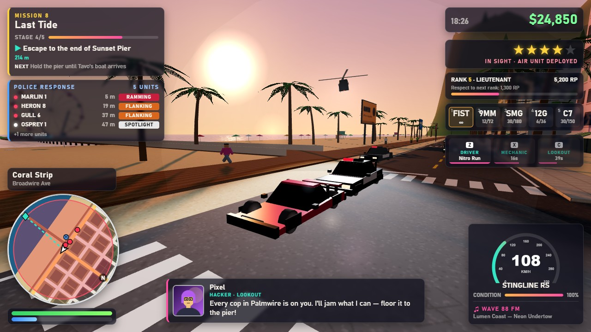

[](https://make.fun/bounty/gta6-01?utm_source=github&utm_medium=readme&utm_campaign=gta6-01)
[](https://make.fun/bounty/gta6-01/leaderboard?utm_source=github&utm_medium=readme&utm_campaign=gta6-01)
[](https://make.fun/bounty/gta6-01?utm_source=github&utm_medium=readme&utm_campaign=gta6-01)

# Palmwire City — *Saltwater Ledger*

An original open-world crime game set on a sun-soaked stretch of coast, built with three.js and
plain ES modules. It runs offline in desktop Chrome from the static files in `game/` — no build
step, no downloads, every texture painted on a canvas and every sound synthesized with WebAudio.



## The story

Getaway driver **Sol Arroyo** comes home after four years upstate to find developer **Marcus Vell**
squeezing the Coral Strip with a bought cop, **Lt. Dana Kroll**, and the muscle of the **Harbor
Kings**. Fixer **Auntie Vee** (Suds & Sons Laundromat) runs the jobs; Sol builds a crew —
**Grease** the mechanic, **Tavo** the street racer and **Pixel** the hacker — and works through
eight story missions (3–5 stages each): *Homecoming, Low Tide, Shore Thing, Paper Palms, Badge
Money, Neon Static, Kroll's Due* and *Last Tide*.

## What's in the city

- **A seeded 14×14-block city**: Glasswater downtown towers, the Coral Strip hotels and beach with a
  boardwalk, Sunset Pier and its Ferris wheel, Palm Court houses, Calle Mango shops, the Saltwater
  Canal with bridges, the Rustline Docks with cranes and containers, Verde Heights park and the
  PALMWIRE hillside letters. Lane markings, crosswalks, working traffic signals, street lamps,
  palms, billboards for invented brands, parked cars, animated ocean.
- **Golden-hour lighting and a full day/night cycle**: moving sun with glare, fog, shadows, lit
  windows, street-lamp pools, headlights, stars.
- **Nine original vehicles** (Pipit Hatch, Meridian Sedan, Hammerhead GT, Mesquite Pickup, Stingline
  RS, Dockrunner Van, Wasp 250 motorbike, Sunshade Cab, PCPD Interceptor) with arcade physics,
  handbrake drifts, skid marks, tyre smoke, damage, fire and explosions, horn, sirens and radio.
- **Traffic AI** that follows lanes, obeys signals and brakes for people; **pedestrians** who walk
  the sidewalks, cross streets, and scatter from gunfire, bodies and speeding cars.
- **Combat**: fists, Kestrel 9 pistol, Hornet SMG, Breaker 12 shotgun, Tidewater C7 carbine —
  ammo, reloads, aiming, recoil, muzzle flash, tracers, headshots, drive-by shooting, weapon wheel.
- **Wanted level 0–5**: crimes need witnesses; police cruisers route to you, ram and flank,
  officers shoot or arrest, roadblocks from three stars, the *Osprey 1* helicopter with a
  searchlight from four. Break line of sight and leave the search circle to escape. Busted and
  Wasted both cost you.
- **Progression**: cash, respect and eight ranks that unlock weapons, district standing, garage
  upgrades (engine, tyres, armour, repair, respray), crew abilities on hotkeys, safehouse saves.
- **Side activities**: three street races, courier runs, Sunshade Cab fares and a rampage.
- **HUD**: mission card with stage progress and next objective, police response panel (callsign,
  distance, tactic), clock, cash, stars, rank, weapon slots, crew cooldowns, rotating minimap with
  GPS line and search circle, health/armour, dialogue cards with painted portraits, speedometer,
  vehicle condition and radio. Title screen with a procedurally drawn logo, pause, settings,
  controls, full-screen map and progress screen.
- **Audio**: engine with gear changes, tyre squeal, guns, explosions, sirens, surf and gulls, and
  three radio stations whose music is composed live (WAVE 88 FM, Bayside 104.2, Coral Caliente 97.3).

## Controls

| Key | Action |
| --- | --- |
| W A S D | Move / drive |
| Mouse | Look and aim (click the game to capture the mouse) |
| Left / right click | Shoot or punch / aim |
| Shift, Space | Sprint, jump — in a car Space is the handbrake |
| F | Enter, exit or steal a vehicle |
| R | Reload |
| 1–5, mouse wheel, hold Tab | Weapons and weapon wheel |
| Z / X / C | Crew: nitro run, patch job, police scanner jam |
| Q, H, G | Radio station, horn, siren (police car) |
| M | Map and progress |
| Esc / P | Pause |

Yellow markers start story missions, pink ones races, green ones jobs, red the rampage. The blue
marker at Palm Court is the safehouse; the orange one at Okonkwo Auto Works is the garage.

## Running it

```sh
node serve.ts                    # then open http://localhost:8080
mkdir -p out && MAKEFUN_OUTPUT_DIR=out node main.ts   # package the entry
```

URL options: `?play=new` / `?play=continue` skip the title, `?shot=chase|foot|race|map|overview&seed=1`
stage the deterministic screenshot scenes, `?selftest=1` runs a scripted play-through of the main
systems and prints a pass/fail report, `?debug=1` shows any runtime errors.
`node tools/make-screenshots.mjs` re-renders `screenshots/` with headless Chrome (server running).

## Code layout

```
game/index.html, style.css      page shell, import map, HUD and menu styles
game/src/main.js, game.js       boot, frame loop, system wiring and update order
game/src/config.js              city dimensions, districts, street names, landmarks, brands
game/src/core/                  seeded RNG, math, events, input, settings
game/src/world/                 city plan, textures, buildings, roads, water, sky, hills, props,
                                landmarks, colliders, road graph and signals, day cycle
game/src/actors/                humans and their instanced renderer, player, pedestrians, vehicle
                                types/models/physics, traffic, AI driving, police and helicopter,
                                gangs, armed-NPC combat AI
game/src/combat/                weapons and arsenal, hitscan combat, pickups
game/src/fx/                    particles, tracers, skid marks, flashes and headlights
game/src/gameplay/              wanted level, missions engine and stage types, story, races, side
                                jobs, progression, crew, garage, save/safehouse, respawn, markers
game/src/ui/                    HUD, minimap, map screen, menus, logo, dialogue, garage, weapon wheel
game/src/audio/                 audio engine, sound effects, vehicle sounds, radio, ambience
game/src/shots/                 screenshot scenes and the self-test
```

All names, characters, places, brands and music in Palmwire City are original. MIT licensed.
